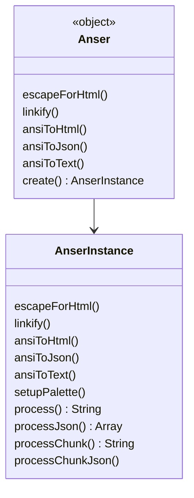
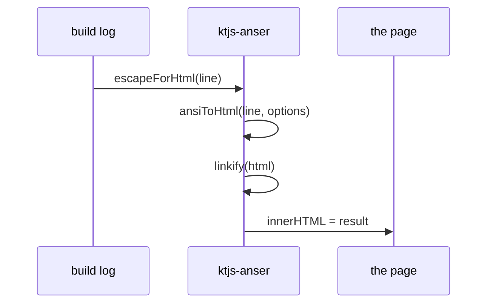

# Usage

## Two halves of one module

anser exports one class (`export = Anser`). The wrapper splits it the way Kotlin reads best: the statics
are an object, the instance methods are a class, and both are typed.



`Anser.create()` builds an instance with `Reflect.construct`: the module *is* the class, and an
external class cannot be `new`-ed through a module value. The wrapper does that once, so call sites
just call `create()`.

## The statics

```kotlin
val html = Anser.ansiToHtml("\u001b[1;32mOK\u001b[0m 12 tests")
val json = Anser.ansiToJson("\u001b[1;32mOK\u001b[0m 12 tests")
val text = Anser.ansiToText("\u001b[1;32mOK\u001b[0m 12 tests")
val escaped = Anser.escapeForHtml("a & b < c")
val linked = Anser.linkify("see https://example.com")
```

The same calls exist as top-level functions (`ansiToHtml("…")`) when the receiver reads better that
way; both delegate to the same object.

## Options

```kotlin
val options = unsafeJso<AnserOptions> {
    use_classes = true   // ansi-*-fg / ansi-bright-*-fg instead of inline colours
    json = false
    remove_empty = false
}
val html = Anser.ansiToHtml(input, options)
```

| Field | Type | Meaning |
| --- | --- | --- |
| `json` | `Boolean?` | return the JSON representation instead of a string (use `ansiToJson` / `processJson` in Kotlin) |
| `use_classes` | `Boolean?` | append anser's CSS classes instead of `style="color:…"` |
| `remove_empty` | `Boolean?` | drop entries whose content is empty |

The field names keep anser's spelling because they are keys of the object anser reads, not Kotlin
identifiers.

## Entries and names

`ansiToJson` returns one `AnserJsonEntry` per span:

| Property | Type | What it holds |
| --- | --- | --- |
| `content` | `String` | the text of the span |
| `fg` / `bg` | `String` | the palette colour name, `""` when unset |
| `fg_truecolor` / `bg_truecolor` | `String` | the 16m colour, when the input used one |
| `decoration` | `DecorationName?` | the decoration declared last before the text |
| `decorations` | `Array<DecorationName>` | every decoration that applies |
| `was_processed` | `Boolean` | anser processed this entry |
| `isEmpty()` | `Boolean` | no content |

`DecorationNames` and `AnserColorNames` hold the values anser emits (`bold`, `dim`, `italic`,
`underline`, `blink`, `reverse`, `hidden`, `strikethrough`; `black` … `white`). Both are sealed literal
types, so a typo is a compile error, and `.of(name)` keeps a name the list does not enumerate.

## Running it from a build log



That is the demo's own loop: the input text area, the `use_classes` switch, then whichever output the
reader picked.
