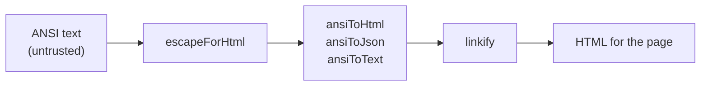

# Introduction

`ktjs-anser` is a Kotlin/JS wrapper around [anser](https://github.com/IonicaBizau/anser), the
converter that turns ANSI SGR escape sequences into HTML, JSON or plain text. It maps the package's
declarations to Kotlin types the compiler checks — no `dynamic`, no hand-written casts at the call site.

## What it does

Most terminal output a browser meets is coloured with escape sequences: `git`, `npm`, `kotlinc`, CI
logs, `docker compose`. anser is what the JavaScript world uses to render them; this module is what a
Kotlin/JS project uses to call anser.

| Output | Entry point | What you get |
| --- | --- | --- |
| HTML | `Anser.ansiToHtml` | ``s with inline colours, or `ansi-*-fg` classes when `use_classes` is set |
| JSON | `Anser.ansiToJson` | one `AnserJsonEntry` per span: content, colours, decorations, truecolour |
| text | `Anser.ansiToText` | the escapes stripped, everything else untouched |
| escaping | `Anser.escapeForHtml` | `&`, `<`, `>` escaped, for input that is not trusted |
| links | `Anser.linkify` | bare URLs in already converted HTML become anchors |

## The pipeline

Escaping comes first: `ansiToHtml` keeps the text it is given, so anything a user typed has to be
escaped before it reaches that call. The demo runs exactly this pipeline, which is why its input area
can be edited freely.

## What is in the repository

| Part | Role |
| --- | --- |
| `ktjs-anser` | the wrapper module: `anser` 2.3.5, one Gradle module, package `io.github.shijianjs.ktjs.anser` |
| `demo` | a runnable demo: an editable input, the option switch and the three outputs; published under `/demo/` |
| `docs` | this site: typed configuration and sidebars, English and Chinese |
| the rest | one `package.json` for npm versions, `-kt.N` module revisions, Detekt, browser tests, Pages workflow |

The API reference under `/api/` is Dokka output for the published module, produced by the same
`pagesSite` task that assembles this site.

## Where to go next

- [Getting started](guide/getting-started.md) — add the dependency, call the converter.
- [Usage](guide/usage.md) — the options, the instance API and the decoration names.
- [Licensing](guide/licensing.md) — the wrapper's MIT licence and anser's own.
