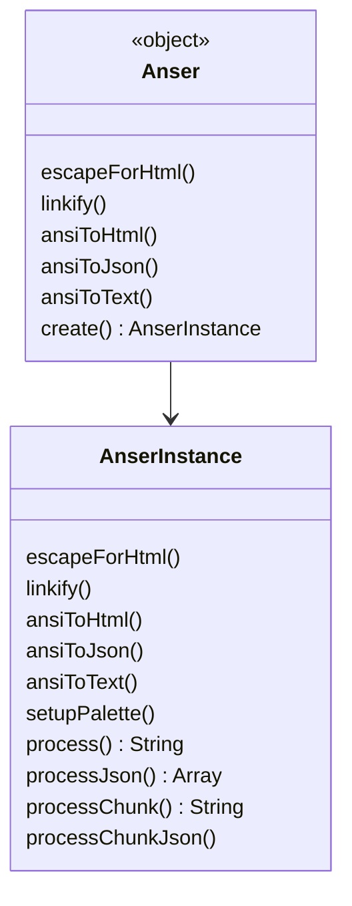
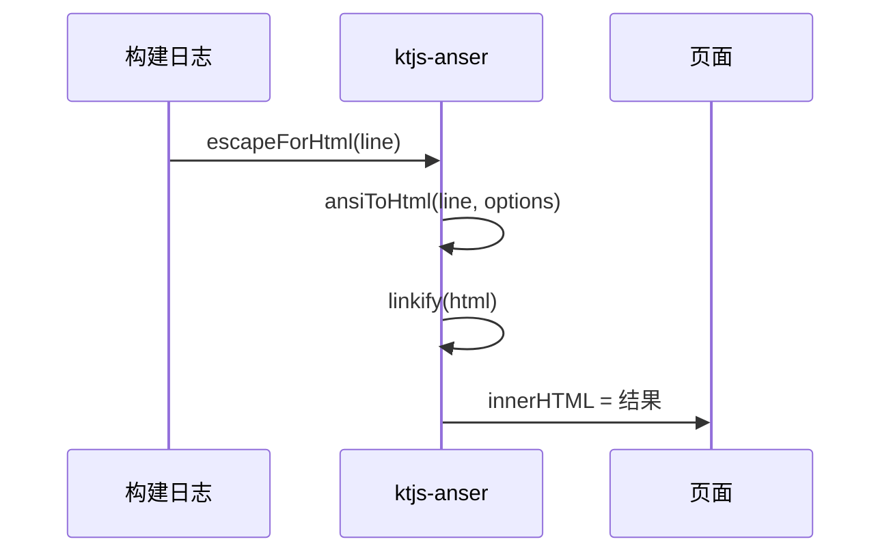

# 用法

## 一个模块，两半

anser 只导出一样东西：一个类（`export = Anser`）。封装按 Kotlin 读起来最顺的方式把它拆开——静态部分是对象，
实例方法是类，两边都有类型。



`Anser.create()` 用 `Reflect.construct` 造实例：模块值本身就是那个类，而 external 类不能通过模块值 `new`。
这层细节只做一次，调用处直接 `create()`。

## 静态方法

```kotlin
val html = Anser.ansiToHtml("\u001b[1;32mOK\u001b[0m 12 tests")
val json = Anser.ansiToJson("\u001b[1;32mOK\u001b[0m 12 tests")
val text = Anser.ansiToText("\u001b[1;32mOK\u001b[0m 12 tests")
val escaped = Anser.escapeForHtml("a & b < c")
val linked = Anser.linkify("see https://example.com")
```

同样的调用也有顶层函数形式（`ansiToHtml("…")`），在不需要接收者的地方更短；两者都委托到同一个对象。

## 选项

```kotlin
val options = unsafeJso<AnserOptions> {
    use_classes = true   // 用 ansi-*-fg / ansi-bright-*-fg 代替内联颜色
    json = false
    remove_empty = false
}
val html = Anser.ansiToHtml(input, options)
```

| 字段 | 类型 | 含义 |
| --- | --- | --- |
| `json` | `Boolean?` | 返回 JSON 表示而不是字符串（Kotlin 侧用 `ansiToJson` / `processJson`） |
| `use_classes` | `Boolean?` | 追加 anser 的 CSS class，而不是 `style="color:…"` |
| `remove_empty` | `Boolean?` | 丢掉内容为空的片段 |

字段名保留 anser 的拼写：它们是 anser 读取的对象键，不是 Kotlin 标识符。

## 片段与名字

`ansiToJson` 每个片段返回一个 `AnserJsonEntry`：

| 属性 | 类型 | 内容 |
| --- | --- | --- |
| `content` | `String` | 片段文本 |
| `fg` / `bg` | `String` | 调色板颜色名，未设置时为空串 |
| `fg_truecolor` / `bg_truecolor` | `String` | 输入用了 16m 颜色时的值 |
| `decoration` | `DecorationName?` | 文本之前最后声明的装饰 |
| `decorations` | `Array<DecorationName>` | 生效的全部装饰 |
| `was_processed` | `Boolean` | anser 是否处理过该片段 |
| `isEmpty()` | `Boolean` | 内容为空 |

`DecorationNames` 与 `AnserColorNames` 收着 anser 会输出的取值（`bold`、`dim`、`italic`、`underline`、
`blink`、`reverse`、`hidden`、`strikethrough`；`black` 到 `white`）。两者都是 sealed 字面量类型，拼错就是
编译错误；`.of(name)` 留给上游未枚举的名字。

## 从构建日志跑一遍



demo 自己就是这段循环：输入文本区、`use_classes` 开关，然后挑一种输出。
