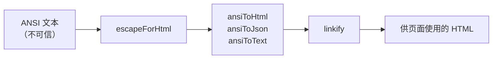

# 介绍

`ktjs-anser` 是围绕 [anser](https://github.com/IonicaBizau/anser) 的 Kotlin/JS 封装：把 ANSI SGR
转义序列转成 HTML、JSON 或纯文本。上游声明被映射成编译器能检查的 Kotlin 类型——不出现 `dynamic`，
调用处也不写手写转换。

## 它能做什么

浏览器里遇到的终端输出大多靠转义序列着色：`git`、`npm`、`kotlinc`、CI 日志、`docker compose`。
JavaScript 世界用 anser 渲染它们，这个模块让 Kotlin/JS 项目直接调用 anser。

| 输出 | 入口 | 得到什么 |
| --- | --- | --- |
| HTML | `Anser.ansiToHtml` | 带内联颜色的 ``；设了 `use_classes` 时是 `ansi-*-fg` class |
| JSON | `Anser.ansiToJson` | 每个片段一个 `AnserJsonEntry`：内容、前景/背景、装饰、truecolor |
| 纯文本 | `Anser.ansiToText` | 去掉转义，其余原样保留 |
| 转义 | `Anser.escapeForHtml` | 转义 `&`、`<`、`>`，给不信任的输入用 |
| 链接 | `Anser.linkify` | 把已转换 HTML 里的裸链接变成 `<a>` |

## 流水线

转义必须在前：`ansiToHtml` 会原样保留传入的文本，所以用户输入要先转义再交给它。demo 跑的正是这条
流水线，因此它的输入框可以随便改。

## 仓库里有什么

| 部分 | 作用 |
| --- | --- |
| `ktjs-anser` | 封装模块：`anser` 2.3.5，一个 Gradle 模块，包名 `io.github.shijianjs.ktjs.anser` |
| `demo` | 可运行的演示：可编辑输入、选项开关、三种输出；发布在 `/demo/` |
| `docs` | 本站：类型化配置与侧边栏，中英双语 |
| 其余 | 一份 `package.json` 管 npm 版本、`-kt.N` 模块修订号、Detekt、浏览器测试、Pages 工作流 |

`/api/` 下的 API 文档是发布模块的 Dokka 输出，由 `pagesSite` 与本站一起装配。

## 接下来

- [快速开始](guide/getting-started.md) —— 加依赖，调用转换器。
- [用法](guide/usage.md) —— 选项、实例 API 与装饰名。
- [许可](guide/licensing.md) —— 本封装的 MIT 许可与 anser 自身的许可。
